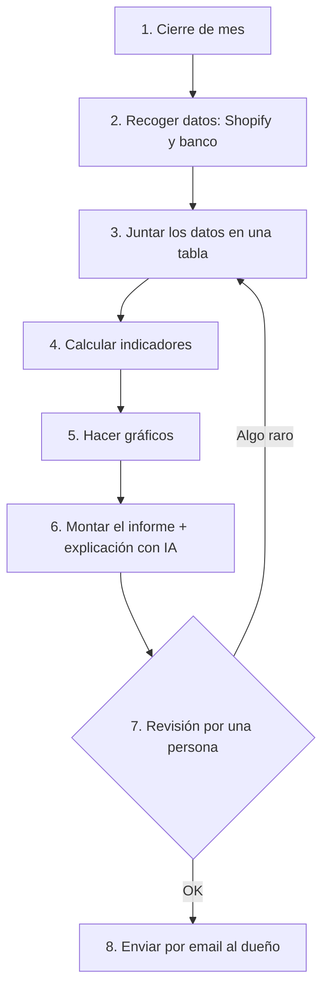

# Proyecto 1 · Mapa de un proceso: el «director financiero de bolsillo»

## El problema
Una pequeña marca de ropa que vende online con **Shopify** quiere saber cada mes cómo va el negocio. Hoy alguien lo prepara a mano: descarga datos, los junta en un Excel, hace cuentas y gráficos y se los manda al dueño. Pierde horas cada mes y es fácil equivocarse.

## El proceso hoy (a mano) y qué se puede automatizar

| # | Paso | ¿Automatizable? | Cómo |
|---|---|---|---|
| 1 | Cierre de mes | ✅ | Un calendario lanza el proceso el día 1 de cada mes |
| 2 | Recoger datos de Shopify (ventas, devoluciones, stock) y del banco (gastos) | ✅ | API de Shopify; extracto del banco exportado |
| 3 | Juntar los datos en una sola tabla | ✅ | Google Sheets o una base de datos |
| 4 | Calcular: ventas, gastos, beneficio, margen por prenda, devoluciones, stock y comparación con el mes anterior | ✅ | Fórmulas fijas (Python o la propia herramienta) |
| 5 | Hacer los gráficos | ✅ | Gráficos generados automáticamente |
| 6 | Montar el informe y explicar los números en lenguaje sencillo («este mes has ganado menos porque…») | ✅ | Plantilla + un modelo de IA (LLM) |
| 7 | Revisar que las cifras tienen sentido | ❌ | Lo hace una persona: alguien tiene que responder de los números |
| 8 | Enviar el informe al dueño | ✅ | Email automático, solo después del paso 7 |

**Resultado:** 7 de los 8 pasos se pueden automatizar. La persona solo revisa y aprueba.

## Herramientas previstas
n8n (proyecto 3), APIs (proyecto 2), IA (proyecto 4), Python (proyecto 5) y SQL (proyecto 6). Cada paso del portfolio construirá una pieza de este sistema.
