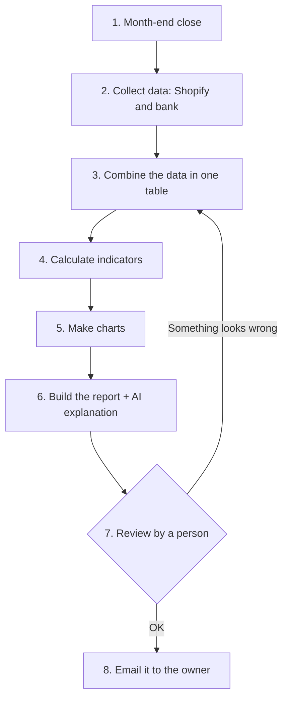

# Project 1 · Process map: the "pocket CFO"

## The problem
A small clothing brand that sells online with **Shopify** wants to know how the business is doing every month. Today someone prepares it by hand: they download data, put it together in Excel, do the maths and the charts, and send it to the owner. It takes hours every month and it's easy to make mistakes.

## The process today (by hand) and what can be automated

| # | Step | Automatable? | How |
|---|---|---|---|
| 1 | Month-end close | ✅ | A schedule starts the process on the 1st of every month |
| 2 | Collect data from Shopify (sales, returns, stock) and from the bank (expenses) | ✅ | Shopify API; exported bank statement |
| 3 | Combine the data in a single table | ✅ | Google Sheets or a database |
| 4 | Calculate: sales, expenses, profit, margin per item, returns, stock and comparison with the previous month | ✅ | Fixed formulas (Python or the tool itself) |
| 5 | Make the charts | ✅ | Automatically generated charts |
| 6 | Build the report and explain the numbers in plain language ("this month you earned less because…") | ✅ | Template + an AI model (LLM) |
| 7 | Check that the figures make sense | ❌ | A person does it: someone has to be accountable for the numbers |
| 8 | Send the report to the owner | ✅ | Automatic email, only after step 7 |

**Result:** 7 of the 8 steps can be automated. The person only reviews and approves.

## Planned tools
n8n (project 3), APIs (project 2), AI (project 4), Python (project 5) and SQL (project 6). Each step of the portfolio builds one piece of this system.
