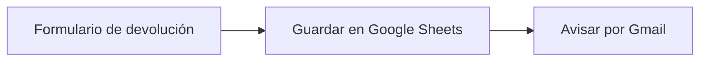

# Proyecto 3 · Devoluciones automáticas con n8n

## El problema
La marca de ropa del [proyecto 1](../01-mapa-proceso/) recibe solicitudes de devolución por email, cada una con un formato distinto. Alguien tiene que copiarlas a mano en una hoja de cálculo y avisar al equipo. Es lento, se pierden datos y las devoluciones son una de las cifras del informe mensual.

## La solución
Un flujo de **n8n** con 3 pasos:

1. **Formulario:** el cliente rellena nombre, email, pedido, producto, talla, motivo y comentarios. La talla y el motivo se eligen de una lista, así los datos llegan siempre iguales.
2. **Google Sheets:** cada solicitud se guarda como una fila nueva en la hoja `Devoluciones`.
3. **Gmail:** la tienda recibe un email con el resumen de la devolución.

Resultado: cero copiar y pegar, datos ordenados y aviso al momento.

## Cómo usarlo
1. Ejecuta n8n en local: `npx n8n` (necesita Node.js 24 o superior) y abre `http://localhost:5678` en Chrome.
2. Crea en Google Cloud un cliente OAuth (tipo «Aplicación web») con las APIs de Sheets, Drive y Gmail activadas. Añade tu cuenta como usuario de prueba y usa como URI de redirección `http://localhost:5678/rest/oauth2-credential/callback`.
3. En n8n, crea las credenciales «Google Sheets OAuth2 API» y «Gmail OAuth2 API».
4. Crea una hoja con estas columnas en la fila 1: `Fecha | Nombre | Email | Pedido | Producto | Talla | Motivo | Comentarios`.
5. Importa [`flujo-devoluciones.json`](flujo-devoluciones.json) (menú ⋯ → Import from File).
6. En el nodo de Sheets, elige tu credencial, la hoja y la pestaña. Después vuelve a **mapear** cada columna arrastrando los datos del formulario: n8n vacía el mapeo al cambiar de hoja.
7. En el nodo de Gmail, elige tu credencial y cambia `PON_AQUI_TU_EMAIL` por tu email.
8. Pulsa **Execute workflow** y rellena el formulario.

## Qué he aprendido
- **Nodos y conexiones:** cada nodo es un puesto de la cadena y las flechas pasan los datos al siguiente.
- **«Execute step» no es «Execute workflow»:** el primero prueba solo un nodo; el segundo, el flujo entero.
- **Mapear datos:** arrastrar campos de entrada a columnas genera expresiones como `{{ $json.Nombre }}`.
- **n8n lee las columnas de la fila 1 de la hoja:** si una cabecera falta o está mal escrita, su casilla no aparece.
- **OAuth con Google:** cómo dar a una herramienta permiso solo para las APIs que necesita, y que en modo prueba solo entran los usuarios añadidos.
- **Safari bloquea la sesión de n8n en local**: con Chrome funciona.
