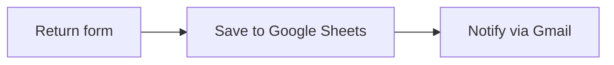

# Project 3 · Automated returns with n8n

## The problem
The clothing brand from [project 1](../01-mapa-proceso/) receives return requests by email, each in a different format. Someone has to copy them by hand into a spreadsheet and notify the team. It's slow, data gets lost, and returns are one of the figures in the monthly report.

## The solution
An **n8n** workflow with 3 steps:

1. **Form:** the customer fills in name, email, order, product, size, reason and comments. Size and reason are picked from a list, so the data always arrives in the same format.
2. **Google Sheets:** each request is saved as a new row in the `Devoluciones` (Returns) sheet.
3. **Gmail:** the store receives an email with a summary of the return.

Result: zero copy-pasting, tidy data and instant notification.

## How to use it
1. Run n8n locally: `npx n8n` (requires Node.js 24 or later) and open `http://localhost:5678` in Chrome.
2. In Google Cloud, create an OAuth client (type "Web application") with the Sheets, Drive and Gmail APIs enabled. Add your account as a test user and use `http://localhost:5678/rest/oauth2-credential/callback` as the redirect URI.
3. In n8n, create the "Google Sheets OAuth2 API" and "Gmail OAuth2 API" credentials.
4. Create a sheet with these columns in row 1: `Fecha | Nombre | Email | Pedido | Producto | Talla | Motivo | Comentarios` (date, name, email, order, product, size, reason, comments).
5. Import [`flujo-devoluciones.json`](flujo-devoluciones.json) (⋯ menu → Import from File).
6. In the Sheets node, choose your credential, the spreadsheet and the tab. Then **map** each column again by dragging the form data: n8n clears the mapping when you change the spreadsheet.
7. In the Gmail node, choose your credential and replace `PON_AQUI_TU_EMAIL` with your email.
8. Click **Execute workflow** and fill in the form.

## Why I built it this way
- **The problem:** handling returns by hand wastes time and loses information along the way, and it's hard to have all the data collected in one place to study it later. It's also a common problem in many companies.
- **Alternatives:** it can also be done with Make, which is more visual but, in my opinion, less practical (I compare them in [project 7](../07-make-devoluciones/)).
- **Why n8n and this combination:** n8n was the most requested tool in the job offers I analysed. The form → Sheets → email combination isn't very long, but it already automates two actions.
- **What I would change for a real company:**
  - I would put it in the cloud: right now it runs on my computer, and if I turn it off the workflow stops.
  - I would build a form tailored to the problem and the company, and polish the details of the experience.
  - The technical base wouldn't change much, but now I would build it faster and more accurately.

## What I learned
- **Nodes and connections:** each node is a station on the assembly line and the arrows pass the data to the next one.
- **"Execute step" is not "Execute workflow":** the first tests a single node; the second, the whole workflow.
- **Mapping data:** dragging input fields onto columns generates expressions like `{{ $json.Nombre }}`.
- **n8n reads the columns from row 1 of the sheet:** if a header is missing or misspelled, its field doesn't show up.
- **OAuth with Google:** how to give a tool permission only for the APIs it needs, and that in test mode only the accounts added as test users can sign in.
- **Safari blocks the local n8n session:** it works with Chrome.
