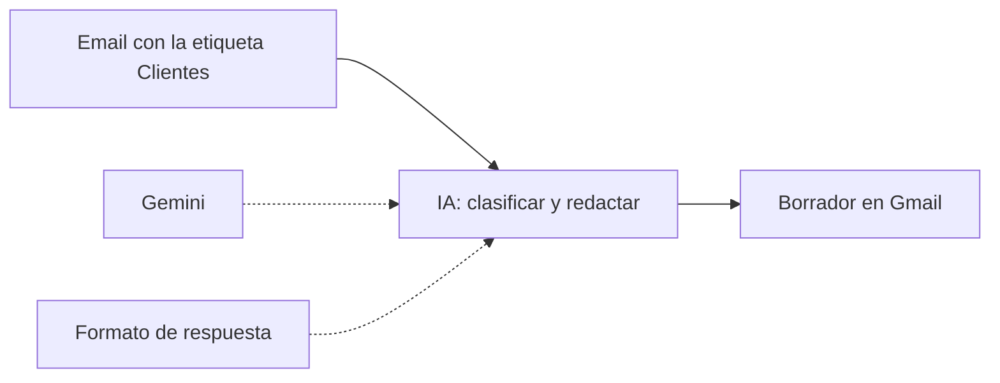

# Proyecto 4 · Atención al cliente con IA

## El problema
La marca de ropa del [proyecto 1](../01-mapa-proceso/) recibe muchos emails repetidos, sobre todo «¿dónde está mi pedido?» y dudas sobre devoluciones. Contestarlos uno a uno a mano quita horas cada semana.

## La solución
Un flujo de **n8n** con IA (**Google Gemini**):

1. **Disparador:** n8n solo lee los emails con la etiqueta `Clientes` y deja en paz el resto del correo.
2. **IA:** Gemini clasifica el email (`donde_esta_mi_pedido`, `devolucion` u `otra`) y redacta una respuesta breve en el idioma del cliente.
3. **Formato de respuesta:** obliga a la IA a contestar siempre con las mismas dos casillas (`categoria` y `respuesta`), para que n8n sepa dónde está cada dato.
4. **Borrador:** la respuesta se guarda como **borrador** en la misma conversación de Gmail. **No se envía sola:** una persona la revisa y pulsa enviar.

**Reglas que sigue la IA:** no inventar fechas, importes ni reembolsos; pedir el número de pedido si falta; mandar las devoluciones al formulario del [proyecto 3](../03-n8n-devoluciones/).

**Ejemplo probado:** el email «Hola, hice el pedido #1023 hace 10 días y aún no me ha llegado» se clasificó como `donde_esta_mi_pedido` y generó un borrador de respuesta.

## Cómo usarlo
1. Ten n8n en marcha y las credenciales de Gmail del [proyecto 3](../03-n8n-devoluciones/).
2. Crea una clave de API de Gemini en [Google AI Studio](https://aistudio.google.com/apikey) y, en n8n, la credencial «Google Gemini(PaLM) Api».
3. En Gmail, crea la etiqueta `Clientes`.
4. Importa [`flujo-atencion-cliente.json`](flujo-atencion-cliente.json). Elige las credenciales en los nodos de Gmail y Gemini, y la etiqueta `Clientes` en el disparador.
5. Ponle la etiqueta `Clientes` a un email de prueba y pulsa **Execute workflow**.

⚠️ **Privacidad:** en el plan gratuito de Gemini, Google usa los datos enviados para mejorar sus productos. Para emails reales de clientes hay que usar un plan de pago.

## Qué he aprendido
- **Sub-nodos:** el modelo de IA y el formato de respuesta se enchufan por debajo del nodo principal.
- **Salida estructurada:** con un ejemplo JSON, la IA siempre responde con las mismas casillas.
- **Humano en el circuito:** la IA prepara el borrador y una persona decide si se envía.
- **Cuotas de la versión gratuita:** Gemini 3.8 Flash permite 20 peticiones al día y los reintentos automáticos también cuentan. Al superarla aparece el error 429.
- **Modelos retirados:** el error 404 indicaba que `gemini-2.5-flash-lite` ya no está disponible para usuarios nuevos y recomendaba `gemini-3.5-flash-lite`. Leer el error entero da la solución.
