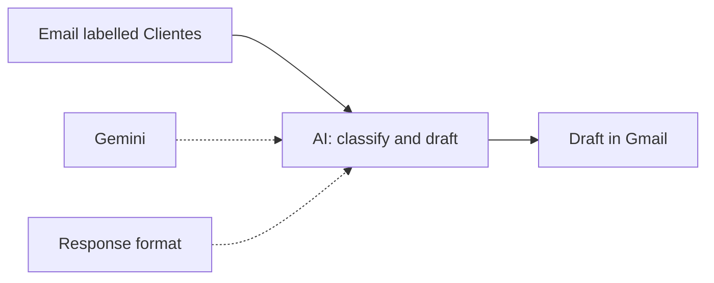

# Project 4 · AI customer service

## The problem
The clothing brand from [project 1](../01-mapa-proceso/) receives lots of repeated emails, mostly "where is my order?" and questions about returns. Answering them one by one by hand takes hours every week.

## The solution
An **n8n** workflow with AI (**Google Gemini**):

1. **Trigger:** n8n only reads emails with the `Clientes` (Customers) label and leaves the rest of the inbox alone.
2. **AI:** Gemini classifies the email (`donde_esta_mi_pedido` = where is my order, `devolucion` = return, or `otra` = other) and writes a short reply in the customer's language.
3. **Response format:** forces the AI to always answer with the same two fields (`categoria` and `respuesta`: category and reply), so n8n knows where each piece of data is.
4. **Draft:** the reply is saved as a **draft** in the same Gmail conversation. **It isn't sent on its own:** a person reviews it and clicks send.

**Rules the AI follows:** don't make up dates, amounts or refunds; ask for the order number if it's missing; send returns to the form from [project 3](../03-n8n-devoluciones/).

**Tested example:** the email "Hi, I placed order #1023 10 days ago and it still hasn't arrived" (originally in Spanish) was classified as `donde_esta_mi_pedido` and generated a draft reply.

## How to use it
1. Have n8n running and the Gmail credentials from [project 3](../03-n8n-devoluciones/).
2. Create a Gemini API key in [Google AI Studio](https://aistudio.google.com/apikey) and, in n8n, the "Google Gemini(PaLM) Api" credential.
3. In Gmail, create the `Clientes` label.
4. Import [`flujo-atencion-cliente.json`](flujo-atencion-cliente.json). Choose the credentials in the Gmail and Gemini nodes, and the `Clientes` label in the trigger.
5. Add the `Clientes` label to a test email and click **Execute workflow**.

⚠️ **Privacy:** on Gemini's free plan, Google uses the data you send to improve its products. For real customer emails you need a paid plan.

## Why I built it this way
- **The problem:** answering by hand takes a huge amount of time, and the replies are usually the same. Also, a serious company is expected to reply in a consistent and formal way, and that can slip when each reply is written by a different person.
- **Alternatives:** I used the standard, free version of Gemini. There are more powerful paid AI models that aren't very expensive, but these replies don't need that much power: for an SME a simple model is enough (paid, though, for privacy; see below).
- **Why Gemini:** I built the whole process inside the Google ecosystem, for convenience and compatibility between the tools.
- **Why a draft and not automatic sending:** so that a person supervises the reply. AI sometimes makes mistakes, so the human work goes into critical thinking: if the reply is right, it gets sent; if it's wrong, it gets fixed.
- **What I would change for a real company:**
  - I would put it in the cloud instead of on my computer.
  - I would use a paid, more private option: the free version collects the data, and here it would be real customer emails.
  - I would define more precisely what the AI can answer. When it can't, the draft would say so depending on the case: if the question is about the company, that someone from the team will get in touch; if it isn't, make that clear and say it can't give an answer.

## What I learned
- **Sub-nodes:** the AI model and the response format plug in underneath the main node.
- **Structured output:** with a JSON example, the AI always answers with the same fields.
- **Human in the loop:** the AI prepares the draft and a person decides whether to send it.
- **Free-tier quotas:** the first model I tried, Gemini 3.8 Flash, allows 20 requests a day, and automatic retries count too. Going over it triggers a 429 error.
- **Retired models:** the 404 error said that `gemini-2.5-flash-lite` is no longer available to new users and recommended `gemini-3.5-flash-lite`, which is the model the workflow uses. Reading the whole error gives you the solution.
