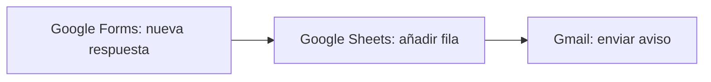

# Proyecto 7 · El mismo flujo en Make: comparación con n8n

## El objetivo
Rehacer el flujo de devoluciones del [proyecto 3](../03-n8n-devoluciones/) con otra herramienta, **Make**, para comparar las dos con el mismo trabajo. Make aparece en 8 de las 19 ofertas analizadas y n8n en 14.

## El escenario en Make

1. **Google Forms · Watch Responses:** detecta cada solicitud de devolución nueva.
2. **Google Sheets · Add a Row:** la guarda en la hoja `Devoluciones`, la misma del proyecto 3.
3. **Gmail · Send an Email:** avisa a la tienda con el resumen de la devolución.

Lo he probado con «Run once» (sin activar la programación, para no gastar créditos del plan gratuito).

## Problemas que encontré y cómo los resolví
- **El asunto mostraba código (`{"questionId":…,"textAnswers":…}`) en vez del número de pedido.** Google Forms entrega cada respuesta metida en varias «cajas». Hay que desplegar la respuesta hasta llegar a su `value` y mapear solo ese dato.
- **El email llegaba todo en una línea.** El cuerpo estaba en formato HTML, que no respeta los saltos de línea. Lo arreglé cambiando el formato del cuerpo. Es el mismo problema que tuve en n8n con la opción «HTML».

## Comparación: n8n frente a Make
| | n8n (proyecto 3) | Make (este proyecto) |
|---|---|---|
| Dónde funciona | En mi Mac (`localhost`): solo mientras el ordenador está encendido. Existe n8n Cloud, de pago | En la nube: funciona siempre, sin instalar nada |
| Puesta en marcha | Más técnica: instalar con `npx`, crear un permiso OAuth en Google Cloud | Más sencilla: crear la cuenta y conectar Google con unos clics |
| Mapear datos | Más fácil: el formulario de n8n entrega cada campo directamente | Más laborioso con Google Forms: hay que desplegar cada respuesta hasta su `value` |
| Aspecto | Nodos unidos por flechas | Burbujas, más visual |
| Plan gratuito | Sin límite de ejecuciones si lo instalas tú | 1.000 créditos al mes |
| Marca de agua | Los emails añaden «enviado con n8n», pero se quita en las opciones del nodo (*Append n8n Attribution*) | — |

> Parte de la diferencia al mapear se debe a la fuente de datos (Google Forms frente al formulario propio de n8n), no solo a la herramienta.

## Mi conclusión
- **Personalmente, me resulta más práctico n8n:** mapear los datos es más fácil y lo controlo todo.
- **Para una pyme sin nadie técnico, recomendaría Make:** funciona en la nube, no hay que instalar ni mantener nada y se conecta a Google con unos clics.
- **Si la pyme tiene a alguien con conocimientos básicos, n8n compensa:** es más flexible y, instalado por uno mismo, no tiene límite de ejecuciones.
