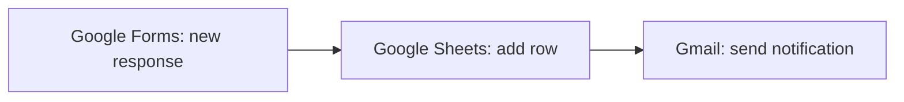

# Project 7 · The same workflow in Make: comparison with n8n

## The goal
Rebuild the returns workflow from [project 3](../03-n8n-devoluciones/) with another tool, **Make**, to compare the two on the same job. Make appears in 8 of the 19 job offers analysed and n8n in 14.

## The scenario in Make

1. **Google Forms · Watch Responses:** detects each new return request.
2. **Google Sheets · Add a Row:** saves it in the `Devoluciones` (Returns) sheet, the same one as in project 3.
3. **Gmail · Send an Email:** notifies the store with a summary of the return.

I tested it with "Run once" (without turning on the schedule, so as not to spend credits from the free plan).

## Problems I ran into and how I solved them
- **The subject showed code (`{"questionId":…,"textAnswers":…}`) instead of the order number.** Google Forms delivers each answer wrapped in several "boxes". You have to expand the answer down to its `value` and map only that piece of data.
- **The email arrived all on one line.** The body was in HTML format, which ignores line breaks. I fixed it by changing the body format. It's the same problem I had in n8n with the "HTML" option.

## Comparison: n8n vs Make
| | n8n (project 3) | Make (this project) |
|---|---|---|
| Where it runs | On my Mac (`localhost`): only while the computer is on. There is n8n Cloud, which is paid | In the cloud: always running, nothing to install |
| Setup | More technical: install with `npx`, create an OAuth permission in Google Cloud | Simpler: create the account and connect Google in a few clicks |
| Mapping data | Easier: the n8n form delivers each field directly | More laborious with Google Forms: you have to expand each answer down to its `value` |
| Look | Nodes joined by arrows | Bubbles, more visual |
| Free plan | No execution limit if you host it yourself | 1,000 credits per month |
| Watermark | Emails add "sent with n8n", but you can remove it in the node options (*Append n8n Attribution*) | — |

> Part of the difference in mapping comes from the data source (Google Forms vs n8n's own form), not just the tool.

## My conclusion
- **Personally, I find n8n more practical:** mapping data is easier and I control everything.
- **For an SME with no technical staff, I would recommend Make:** it runs in the cloud, there's nothing to install or maintain, and it connects to Google in a few clicks.
- **If the SME has someone with basic technical knowledge, n8n is worth it:** it's more flexible and, self-hosted, has no execution limit.
