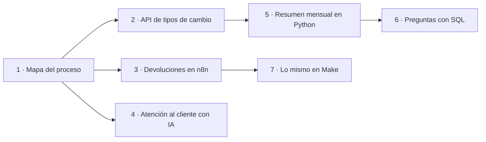

# Portfolio de automatización · Kairu Ferrín

Estudiante de Economía en la UB que aprende automatización para pymes. Ya he creado webs (mi primera web en HTML y el tema de una tienda Shopify) y me interesan las finanzas.

## About me
I'm Kairu, an economics student at the University of Barcelona focused on automation and websites for small and medium-sized businesses (SMEs). My first real-world project, which I worked on for months, went far beyond a website: I helped a baby-care consultant turn her expertise into a complete business, from positioning and branding to a bilingual Shopify site, legal pages, a WhatsApp-based contact flow and an affiliate revenue stream. This portfolio shows automation projects built with n8n, Make, Google Sheets, Gmail, Google Gemini (AI), Python, SQL (SQLite), REST APIs and Git/GitHub. I work with AI as a development partner: I plan the work, direct the build and review every change before it goes live. I work in English, Spanish and Catalan.

## La historia
Todos los proyectos giran en torno a **una pequeña marca de ropa que vende online con Shopify** (ficticia) y automatizan sus dos caras:

- **Finanzas:** un «director financiero de bolsillo» que cada mes calcula y explica los números del negocio.
- **Operaciones:** devoluciones y atención al cliente sin copiar y pegar.

**Herramientas:** n8n · Make · Google Sheets · Gmail · Google Gemini · Python · SQL (SQLite) · APIs REST · Git y GitHub

## Proyectos
| Nº | Proyecto | Qué aprendo | Estado |
|---|---|---|---|
| 1 | [Mapa de un proceso: «director financiero de bolsillo» para una marca de ropa](01-mapa-proceso/) | Detectar qué se puede automatizar | ✅ Hecho |
| 2 | [Tipos de cambio desde una API para las ventas en dólares y libras](02-api-json/) | APIs y JSON | ✅ Hecho |
| 3 | [Devoluciones automáticas: formulario → Google Sheets → Gmail](03-n8n-devoluciones/) | n8n | ✅ Hecho |
| 4 | [Atención al cliente con IA: clasifica emails y deja borradores de respuesta](04-ia-atencion-cliente/) | IA dentro de un flujo | ✅ Hecho |
| 5 | [Resumen mensual de ventas (datos ficticios) con conversión de moneda](05-python-ventas/) | Python | ✅ Hecho |
| 6 | [Preguntas de negocio con SQL sobre las ventas (datos ficticios)](06-sql-ventas/) | SQL (SQLite) | ✅ Hecho |
| 7 | [El flujo de devoluciones en Make y comparación con n8n](07-make-devoluciones/) | Make | ✅ Hecho |

Cada proyecto tiene su carpeta con un README: el problema, la solución, cómo usarla y lo que aprendí. Los proyectos 5 y 6 usan **datos de ventas ficticios**, generados para practicar.
