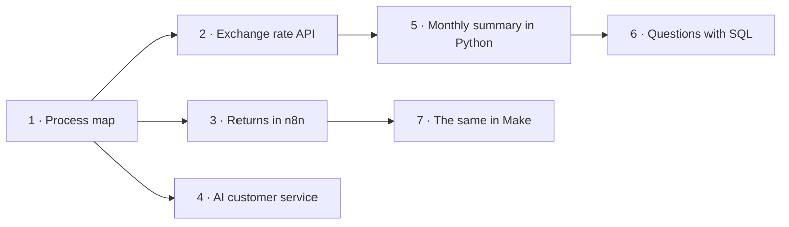

# Automation portfolio · Kairu Ferrín

Learning automation for SMEs. I have already built websites (my first one in HTML and the theme of a Shopify store), and I'm interested in finance.

> **About the language:** Spanish is my native language, so I wrote the code (comments, messages and data) in Spanish, which is more comfortable for me. I publish the documentation in English to reach a wider audience and so more people can understand it.

## About me
I'm Kairu, an economics student at the University of Barcelona focused on automation and websites for small and medium-sized businesses (SMEs). My first real-world project, which I worked on for months, went far beyond a website: I helped a baby-care consultant turn her expertise into a complete business, from positioning and branding to a bilingual Shopify site, legal pages, a WhatsApp-based contact flow and an affiliate revenue stream. This portfolio shows automation projects built with n8n, Make, Google Sheets, Gmail, Google Gemini (AI), Python, SQL (SQLite), REST APIs and Git/GitHub. I work with AI as a development partner: I plan the work, direct the build and review every change before it goes live. I work in English, Spanish and Catalan.

## The story
All the projects revolve around **a small clothing brand that sells online with Shopify** (fictional) and automate its two sides:

- **Finance:** a "pocket CFO" that calculates and explains the business's numbers every month.
- **Operations:** returns and customer service without copy-pasting.

**Tools:** n8n · Make · Google Sheets · Gmail · Google Gemini · Python · SQL (SQLite) · REST APIs · Git and GitHub

## Projects
| # | Project | What I learn | Status |
|---|---|---|---|
| 1 | [Process map: a "pocket CFO" for a clothing brand](01-mapa-proceso/) | Spotting what can be automated | ✅ Done |
| 2 | [Exchange rates from an API for sales in dollars and pounds](02-api-json/) | APIs and JSON | ✅ Done |
| 3 | [Automated returns: form → Google Sheets → Gmail](03-n8n-devoluciones/) | n8n | ✅ Done |
| 4 | [AI customer service: classifies emails and leaves draft replies](04-ia-atencion-cliente/) | AI inside a workflow | ✅ Done |
| 5 | [Monthly sales summary (fictional data) with currency conversion](05-python-ventas/) | Python | ✅ Done |
| 6 | [Business questions with SQL on the sales data (fictional data)](06-sql-ventas/) | SQL (SQLite) | ✅ Done |
| 7 | [The returns workflow in Make, compared with n8n](07-make-devoluciones/) | Make | ✅ Done |

Each project has its own folder with a README: the problem, the solution, how to use it and what I learned. Projects 3 and 4 also explain **why I built them the way I did**. Projects 5 and 6 use **fictional sales data**, generated for practice.
